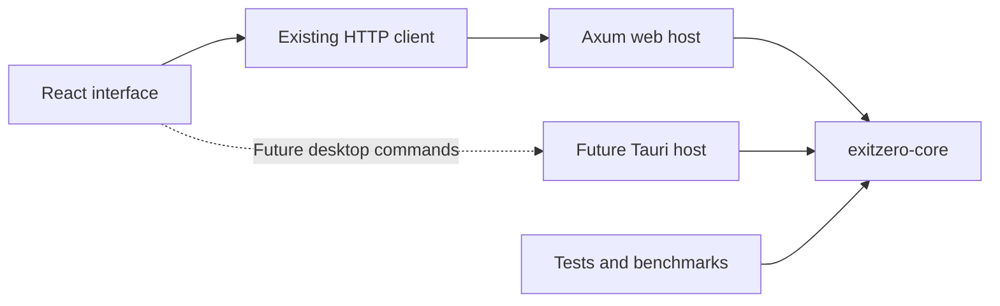

# ExitZero's shared Rust simulation library: extraction and next steps

**Status:** the shared `exitzero-core` crate and Cargo workspace are implemented. The existing web host calls the extracted library. Stateful simulation, a public `step()` API, navigation-library changes, and desktop packaging remain proposals in this guide.

**Direction:** keep ExitZero as a React web application, share its Rust computation through the extracted library, and leave a clean path to a future Tauri desktop application.

This document describes our own library, `exitzero-core`. The migration moves the existing simulation, stress testing, optimization, geometry, and canonical Rust data types into one reusable crate. It preserves their algorithms and JSON contracts. Bevy and a second simulator are not part of this extraction.

## 1. What the library does

The library contains the computations that must behave the same wherever ExitZero runs:

- Validate building configurations.
- Initialize occupants deterministically.
- Represent real geometry and each occupant's remembered geometry.
- Calculate routes and resolve movement conflicts.
- Advance fire, gas, tornado, opening changes, and supported simulation modes.
- Track exposure, injury, evacuation, shelter arrival, and remaining occupants.
- Produce actual animation frames, events, traffic, and congestion measurements.
- Run the existing stress scenarios and optimization candidates.

It accepts ordinary Rust values and returns ordinary Rust values. The application hosts own windows, HTTP, canvas rendering, user files, and playback pacing.

The application hosts provide those capabilities:

| Component               | Responsibility                                                                                                        |
| ----------------------- | --------------------------------------------------------------------------------------------------------------------- |
| `exitzero-core`         | Simulation, validation, analytics, stress testing, optimization, and shared Rust types                                |
| Existing Axum backend   | HTTP, request handling, job registration, admission limits, cancellation endpoints, live pacing, and frontend hosting |
| Existing React frontend | Editor, controls, playback, dashboards, and local layout management                                                   |
| Future Tauri host       | Desktop windows, native file access, and commands that call the same Rust library                                     |

“Library” means a Rust crate linked into its caller. It does not mean another server or an externally published package. Keep it private to this repository initially.

## 2. How the web and future desktop versions share it



For the web application, React continues sending the same JSON to the same backend routes. Those routes call the extracted library through the backend's compatibility re-exports.

For a future desktop application, the React interface could call a Tauri command. That command would call the library directly in a worker. The desktop application would not need to send an internal HTTP request to perform a simulation.

Both hosts would use the same building types, validation, simulation algorithms, and result types. HTTP and desktop IPC would be adapters around that implementation.

Tauri supports web frontends and Rust functionality, which makes this a compatible future packaging option. Desktop packaging can remain a later project; the library boundary is useful immediately. See [Tauri's architecture](https://v2.tauri.app/concept/architecture/).

## 3. What already exists

[The core library](../crates/exitzero-core/src/lib.rs) owns `models`, `simulation`, `stress_testing`, and `optimization`. [The backend library](../backend/src/lib.rs) exposes its API module and re-exports those core modules so existing `exitzero::...` callers continue working.

The current public simulation functions include:

```rust
simulate(&BuildingScenario)
simulate_with_emergencies(&BuildingScenario, &[Emergency])
simulate_live(&BuildingScenario, frame_callback)
simulate_live_with_chat(&BuildingScenario, frame_callback, chat_callback)
```

Stress testing and optimization already call the simulator directly. Their library calls remain direct calls inside core.

Important existing files:

| Current file or directory                                                                               | Relevance to the migration                                          |
| ------------------------------------------------------------------------------------------------------- | ------------------------------------------------------------------- |
| [crates/exitzero-core/src/models](../crates/exitzero-core/src/models)                                   | Canonical Rust request, response, geometry, and result definitions  |
| [crates/exitzero-core/src/simulation/mod.rs](../crates/exitzero-core/src/simulation/mod.rs)             | Public simulation functions and the evacuation tick coordinator     |
| [crates/exitzero-core/src/simulation/pursuit.rs](../crates/exitzero-core/src/simulation/pursuit.rs)     | A separate simulation loop for the existing pursuit mode            |
| [crates/exitzero-core/src/simulation/control.rs](../crates/exitzero-core/src/simulation/control.rs)     | Cooperative cancellation and computation progress                   |
| [crates/exitzero-core/src/simulation/awareness.rs](../crates/exitzero-core/src/simulation/awareness.rs) | Individual knowledge, opening states, and bounded belief-map caches |
| [crates/exitzero-core/src/stress_testing](../crates/exitzero-core/src/stress_testing)                   | Scenario generation, evaluation, ranking, and replay                |
| [crates/exitzero-core/src/optimization](../crates/exitzero-core/src/optimization)                       | Existing bounded candidate evaluation                               |
| [backend/src/api/execution.rs](../backend/src/api/execution.rs)                                         | Worker admission, cancellation registration, and blocking execution |
| [backend/src/api/live.rs](../backend/src/api/live.rs)                                                   | HTTP streaming, output buffering, and wall-clock pacing             |
| [frontend/src/services/api.ts](../frontend/src/services/api.ts)                                         | Existing client requests and response validation                    |
| [shared/schemas/contracts.schema.json](../shared/schemas/contracts.schema.json)                         | Authoritative JSON contracts                                        |
| [README.md](../README.md)                                                                               | Current behavior, commands, and deployment assumptions              |

The root `Cargo.toml` is now a virtual workspace containing `backend/` (`exitzero`) and `crates/exitzero-core/` (`exitzero-core`). Both use the root `Cargo.lock` and `target/` directory. The unused root placeholder executable and backend-specific lockfile have been removed.

The first implementation milestone extracts existing code with equivalent behavior. The tick loop and navigation remain the existing implementations. Reworking navigation and introducing a stateful step API are separate milestones.

## 4. Current repository structure

The extracted crate sits alongside the existing application directories:

```text
ExitZero/
  Cargo.toml                    # Workspace manifest
  Cargo.lock                    # Shared Rust dependency lockfile

  crates/
    exitzero-core/
      Cargo.toml
      src/
        lib.rs
        models/                 # Moved canonical Rust types
        simulation/             # Moved current simulator
        stress_testing/         # Moved existing stress tester
        optimization/           # Moved existing optimizer

  backend/
    Cargo.toml                  # Existing exitzero web package
    src/
      lib.rs                    # API module and compatibility re-exports
      main.rs                   # Existing server executable
      api/
    tests/                      # HTTP/deployment tests and transitional tests
    examples/

  frontend/                     # Existing React application
  shared/                       # Existing schemas and example inputs
  docs/
```

`models`, `simulation`, `stress_testing`, and `optimization` share the core crate. Their existing shared types and computation-control helpers stay internal to that crate. Existing backend integration tests and examples remain in place; moved unit tests stay beside their core implementation.

The models directory moved intact, including serializable live-message and job types. These definitions do not require HTTP or a running server. A later cleanup can separate transport-only types if it has a concrete benefit.

Do not introduce a second collection of building types for the library. Rust, TypeScript, and JSON Schema must continue describing the same data.

## 5. Implemented Cargo setup and build migration

### 5.1 Root workspace

The root manifest now selects both Rust packages and keeps development optimization on the web host and computation crate:

```toml
[workspace]
members = ["backend", "crates/exitzero-core"]
default-members = ["backend", "crates/exitzero-core"]
resolver = "3"

[profile.dev.package.exitzero]
opt-level = 2

[profile.dev.package.exitzero-core]
opt-level = 2
```

The former root placeholder package is no longer an application. The server entry point remains `backend/src/main.rs`.

Cargo workspaces share a root lockfile and target directory, and profile settings belong in the workspace root. See the [Cargo workspace reference](https://doc.rust-lang.org/cargo/reference/workspaces.html) and [profile reference](https://doc.rust-lang.org/cargo/reference/profiles.html).

The `exitzero-core` override preserves optimized simulation code in development after moving it out of the server package.

### 5.2 Core crate

The core package is private to this repository:

```toml
[package]
name = "exitzero-core"
version = "0.1.0"
edition = "2024"
publish = false

[dependencies]
serde = { version = "1", features = ["derive"] }
serde_json = "1"
tokio = { version = "1", features = ["sync"] }
```

`serde_json` is used by existing computation code as well as tests. Tokio's `sync` feature preserves cancellation notification. Core has no Axum, Tauri, Bevy, or renderer dependency.

Its `src/lib.rs` exports the existing domain modules:

```rust
pub mod models;
pub mod optimization;
pub mod simulation;
pub mod stress_testing;
```

### 5.3 Backend dependency and compatibility

`backend/Cargo.toml` depends on the shared crate:

```toml
[dependencies]
exitzero-core = { path = "../crates/exitzero-core" }
# Other dependencies support the existing API and server.
```

The package name uses a hyphen; Rust imports use `exitzero_core`.

The backend keeps compatibility re-exports:

```rust
pub mod api;

pub use exitzero_core::{models, optimization, simulation, stress_testing};
```

Existing callers using `exitzero::simulation::simulate` reference the same implementation and types as new callers using `exitzero_core::simulation::simulate`. The source directories moved; there is no second maintained copy of the simulator.

### 5.4 Lockfile and fixture handling

The root lockfile carries the backend's existing resolved external dependencies. Workspace extraction does not require a general dependency update. Commit changes to the one root lockfile and continue using `--locked` for verification and production builds.

Moved unit tests use manifest-relative fixture includes, for example:

```rust
let building_json = include_str!(concat!(
    env!("CARGO_MANIFEST_DIR"),
    "/../../shared/examples/building.json"
));
```

The same approach handles tests reading frontend presets. Tests remaining in `backend/tests/` retain their existing file depth.

## 6. Implemented crate boundaries

### 6.1 Cancellation notification

`ComputationControl` retains its existing combination of:

- An atomic cancellation flag.
- Progress protected by a mutex.
- A Tokio `Notify` used by the API while awaiting worker admission.
- A thread-local scope for cancellation checks deep inside computation.

`ComputationControl::cancellation()` is now a documented public async method. `api/execution.rs` awaits it across the crate boundary, preserving cancellation that happened before waiting began. Internal checkpoint functions remain private to core.

The core is independent of the web framework while retaining Tokio synchronization. Ordinary synchronous simulation calls do not require a Tokio runtime or an HTTP server.

A later cleanup can separate the computation flag/progress from host-side async notification. Preserve notification ordering and queued cancellation if doing so; removing a dependency alone does not justify polling delays or missed cancellation races.

### 6.2 Stress scenario replay

`stress_testing::record_scenario` is now a documented public entry point used by the web job API. It still verifies that the scenario came from the source request and that replayed metrics match the tested result. Scenario-generation internals remain private.

Other hosts can reuse that entry point rather than reconstruct modifications independently and risk replaying a different experiment.

### 6.3 Host tests use public computation behavior

The execution cancellation test now exercises the public live-simulation runner instead of calling core's private `control::checkpoint()`. Transport admission, worker release, and request-abandonment assertions remain in the backend tests. Internal computation tests remain in core.

### 6.4 Error mapping remains in the host

Core returns `SimulationError` for computation failures. The Axum host maps those errors into the established HTTP status and error JSON. A future desktop host can map the same failures into its command response format.

The library does not import HTTP status codes or create browser-facing error responses.

## 7. Proposed next phase: make simulation state explicit

The crate extraction is complete. The state structures and stepping API described in sections 7–9 have not been implemented.

The current evacuation loop already uses modules for geometry, awareness, navigation, motion, hazards, windows, and analytics. The main refactor is to make the coordinator's state and stage boundaries explicit.

Start by moving long-lived local variables into internal state structures without changing iteration order or calculations:

| State group       | Examples                                                                                       |
| ----------------- | ---------------------------------------------------------------------------------------------- |
| World state       | Physical opening states, hazards, geometry, window service, shelter admissions                 |
| Occupant state    | Position, injury, knowledge, route, waypoint cursor, escape guidance, motion, waiting counters |
| Planning state    | Belief-map cache, crowd memory, route commitments, retry timing                                |
| Run state         | Tick index, population totals, termination reason, stagnation tracking                         |
| Measurement state | Distance, exposure, traffic, congestion, per-agent statistics                                  |
| Recording state   | Retained frames, event history, live/saved sampling cursors                                    |

Keep fields private. Callers should not be able to move an occupant through a wall or mark an evacuation by mutating library internals.

The first state extraction can preserve the current vectors. Grouping per-agent fields into an `AgentRuntime` structure can follow separately. Stable IDs, deterministic ordering, and simultaneous position snapshots matter more than the choice of collection.

### 7.1 Handle Rust ownership before designing the public type

Several current structures borrow the scenario: `Geometry<'a>`, `OpeningStates<'a>`, `Windows<'a>`, and `BeliefMaps<'a>`. Geometry also keeps references to obstruction records.

An owning structure containing both a building and caches borrowing that building would be self-referential. Moving the structure could invalidate the intended relationship. Do not solve this by leaking a building, adding unsafe lifetime casts, or cloning the full building every tick.

The smallest initial design is an externally owned prepared configuration:

```rust
// Proposed API shapes; these types do not exist yet.
pub struct PreparedScenario {
    // Owns validated configuration and normalized window defaults.
    // Fields remain private.
}

pub struct Simulation<'scenario> {
    // Borrows the prepared configuration.
    // Owns mutable run state and borrowed geometry/planning structures.
    // Fields remain private.
    // ...
}
```

`PreparedScenario::new(building)` should validate the input and apply the existing `with_window_escape_defaults()` normalization before dependent caches are constructed. Preserve the supplied seed and time step. Preserve validation of legacy extra `Emergency` zones in the corresponding compatibility runner.

The prepared configuration lives longer than a run. A future owned-geometry design using stable indices could remove these lifetimes, but that is not required for the initial extraction.

### 7.2 Keep initialized simulations on their worker

The current belief-map cache contains `Rc` values, so an initialized simulation containing it is not `Send`.

Move the input configuration and thread-safe cancellation handle into a worker, then construct, step, and finish the simulation inside that worker. Return serializable output values. Do not construct a borrowed simulation in an async request handler and attempt to move it into `spawn_blocking` afterward.

There is no need to replace every `Rc` with `Arc` if a run stays on one worker. Parallelism between independent scenarios can be considered separately, with explicit worker and memory limits.

## 8. Define one deterministic step

An advancing call to the proposed `Simulation::step()` advances exactly one configured `time_step_seconds`. It does not accept elapsed browser time or an arbitrary caller-supplied delta. A call can instead report termination without advancing when an existing pre-movement check applies, such as no active routes or the step limit.

Illustrative usage, after implementing the proposed state and recorder APIs:

```rust
let prepared = PreparedScenario::new(building)?;
let mut simulation = Simulation::new(&prepared)?;
let mut recording = RecordingBuilder::new(&simulation);

while !simulation.is_finished() {
    let outcome = simulation.step()?;
    recording.observe(&mut simulation, &outcome)?;
}

let result = recording.finish(simulation)?;
```

This is a design sketch, not code that currently compiles against the repository. `observe` must distinguish snapshot access from draining measurement deltas, and `finish` must enforce finalization exactly once.

The internal step outcome should distinguish an advanced tick from termination without advancement, and indicate whether the run has ended. This preserves early termination at step zero without inventing movement or duplicate frames. These are internal Rust API details; they do not require new JSON result fields.

Recommended lifecycle:

1. Validate and normalize configuration.
2. Initialize geometry, occupants, knowledge, and measurements.
3. Make the complete step-zero frame available before movement.
4. Advance through bounded deterministic steps.
5. Stop with an existing completion or termination reason.
6. Finalize the recording and result once.

After terminal cancellation or a computation error, reject further stepping. A deep cancellation checkpoint can interrupt partially updated internal state; that state must not become a completed frame or a resumable successful run.

### 8.1 Preserve the current stage order first

The following groups describe the existing evacuation coordinator. They are extraction boundaries, not permission to rearrange its operations:

| Stage                               | Behavior that must stay ordered                                                                                                      |
| ----------------------------------- | ------------------------------------------------------------------------------------------------------------------------------------ |
| Start-of-tick checks and perception | Check completion; observe current world state; collect one-hop reports using the existing snapshot rules                             |
| Forced decisions                    | Handle changed knowledge, blocked destinations, shelter availability, and window fallback                                            |
| Bound checks and planning           | Preserve no-active-route and step-limit handling; snapshot positions; build crowd forecasts; reassess routes and local hazard escape |
| Movement proposals                  | Compute intents from common positions, then proposals using the same crowd and obstacle constraints                                  |
| Conflict resolution                 | Apply cooperative corrections and exact swept geometry/body checks                                                                   |
| Hazard interval                     | Call the equivalent of `prepare_hazards(step + 1)` before integrating relative person/hazard exposure                                |
| Acceptance and arrivals             | Update accepted positions, injury, waiting, waypoint progress, and candidate arrivals                                                |
| Measurement and population updates  | Accumulate traffic and congestion at the existing point, then resolve deterministic shelter/window/exit outcomes                     |
| World refresh and output            | Apply opening changes with actual occupant clearance, refresh geometry, advance service, emit dialogue/frames, and check stagnation  |

For example, advancing a spreading fire only at the start of a tick could alter exposure integration. Closing a door before checking bodies could trap a body inside solid geometry. Removing arrivals before existing traffic collection could alter measurements.

Initially extract operations in their current order and compare outputs. A later algorithm change can intentionally revise ordering with its own tests and explanation.

### 8.2 Keep playback speed outside physics

At 1× or 8×, a tick must advance the same simulated time and perform the same calculations. The host changes how quickly it requests or publishes ticks, not how far occupants move per tick.

The current HTTP live adapter already owns wall-clock pacing. Keep that responsibility there. Offline stress runs should execute without playback sleeps.

Pause/resume would be a separate feature. Stopping wall-clock pacing must not silently advance simulated time, and cancellation must remain terminal.

## 9. Preserve public runners and supported modes

Keep the existing public simulation functions as compatibility wrappers around the new state API. This lets the current API, benchmarks, stress tester, optimizer, and tests migrate incrementally.

The batch wrapper would initialize a run, drive steps to termination, and return its actual result. The live wrapper would drive the same steps while exposing frame and chat observations at the existing cadence. Callback cancellation must keep its current meaning.

Do not maintain one physics implementation for live runs and another for batch runs.

The existing pursuit mode has its own loop and output rules. Move that implementation unchanged during crate extraction. Later it can have a separate `PursuitSimulation` state under a shared facade, while evacuation has an `EvacuationSimulation` state. Preserve pursuit capture, exit, event, and population semantics rather than forcing them into evacuation-specific fields.

The new public step API can initially support evacuation internally while the existing public runners continue dispatching pursuit to its established implementation. Clearly state supported modes until both have stateful adapters.

## 10. Recording, events, and memory

Separate the current world state from the decision to retain history. A run needs measurements every physics tick, but it does not need to clone its entire history every tick.

Preserve these recording requirements during extraction:

- A complete initial frame with stable occupant IDs and exact initial positions.
- The final frame, including early termination, without duplicate terminal frames.
- Existing saved-frame and live-frame sampling behavior.
- Chat and agent events at their actual simulation steps.
- Separate live and saved congestion-delta drains.
- Traffic and congestion updates every physics tick, regardless of output sampling.
- Actual blocked-opening, window, hazard, shelter, and pursuit state in their existing result fields.

A snapshot getter should not consume event or heatmap deltas. Name draining operations explicitly, or keep them internal to the recording adapter.

Current stress testing and optimization release each run's recording before advancing to the next evaluation. Preserve that behavior. Avoid retaining every full recording in a batch merely because all scenarios now live in one library.

A metrics-only execution option could reduce memory later. Introduce it separately: the current comparison code relies on complete initial positions to verify fair experiments, so that information must remain available even when playback history is omitted. Do not remove required result fields from existing endpoints.

## 11. Navigation boundaries and future library evaluation

The existing visibility-graph planner now lives in core. A future navmesh or ECS migration should remain separate from the completed crate move and from introducing `step()`.

Give routing a small internal boundary that accepts:

- The occupant's current position and usable destinations.
- The occupant's remembered geometry and hazard revisions.
- Agent radius and passage-clearance rules.
- The existing crowd forecast and risk policy.
- Cancellation access and geometry/cache revision information.

Return route guidance and meaningful failure information. Keep local fire escape guidance distinct from an evacuation destination: reaching clear floor does not evacuate a person.

The exact trait shape should follow actual call sites. There is no need to expose all planning internals in the public library API or add a plugin framework.

### 11.1 Keep real geometry separate from individual knowledge

There are two different questions:

1. What movement is physically possible in the real world?
2. What route does this occupant believe is available?

Real collision checks use actual walls, openings, obstructions, and body dimensions. Route decisions use discovered wall fragments, opening reports, obstructions, and observed hazard revisions. A library extraction must preserve both.

Do not replace belief-specific navigation with one globally accurate map. That would reveal unseen blockages and hidden walls to everyone. Keep the current bounded belief-map cache, including its protection of active maps and its handling of precise remembered fragments.

### 11.2 Evaluate a navmesh with ExitZero-specific cases

[Polyanya](https://docs.rs/polyanya/latest/polyanya/) provides Rust pathfinding over navigation meshes and is worth a bounded prototype after extraction. Its suitability for our particular behavior still needs measurement.

Compare the existing planner and prototype on:

- Angled walls and rounded jamb clearance.
- Wide exits with usable spans rather than one fixed target point.
- Runtime door closure and reopening.
- Incomplete wall knowledge and one-hop reports.
- Overlapping hazards and escape from inside exposure.
- Injury-limited movement and local crowd avoidance.
- The existing office, school, gas, tornado, and pursuit inputs.
- Graph/mesh build time, route-query time, cache memory, and total run time.

Workspace extents are not inferred exterior building boundaries. A mesh adapter would need explicit treatment of thick wall material, openings, agent-radius inflation, valid connected floor regions, and unknown space. Mesh polygon discretization also does not authorize changing our continuous-coordinate contracts or adding grid snapping.

Keep exact swept collision checks as the movement authority during any planner experiment. Successful geometric pathfinding alone does not establish correct crowd behavior, fair knowledge, or validated evacuation predictions.

## 12. Web integration

The web host now calls core through its compatibility re-exports. Existing HTTP routes, job APIs, JSON fields, live NDJSON event shapes, and frontend behavior are preserved.

The host flow remains:

```text
Receive and deserialize request
  -> Admit or reject the computation using existing limits
  -> Register its cancellation/progress handle
  -> Execute core code on a blocking worker
  -> Map result or failure into the existing response contract
  -> Release permits and registration
```

Core validation remains authoritative for direct Rust callers as well as HTTP callers. Frontend validation and extraction-layer checks do not replace it.

Continue using bounded worker admission. Tokio's `spawn_blocking` is suitable for executing synchronous work away from async request tasks, but CPU-heavy runs still need explicit concurrency limits. Aborting a blocking-task handle does not terminate computation that has already started; retain cooperative cancellation checks. See [Tokio's blocking-task documentation](https://docs.rs/tokio/latest/tokio/task/fn.spawn_blocking.html).

For live output, preserve the current bounded buffering and disconnect behavior. A slow reader must not accumulate an unbounded queue of frames. Cancellation must remain observable while a worker waits to publish output or pace playback.

Keep the current calculation of application job IDs, reuse rules, recent pre-cancellation IDs, and HTTP error mapping in the host. These are service responsibilities rather than evacuation physics.

## 13. Future desktop integration

The web application now works through the extracted library. Desktop integration remains future work and should be implemented only when prioritized.

### 13.1 Reuse the interface through a transport boundary

React components should request simulations through a small application service rather than import Tauri APIs throughout the editor and dashboard.

A future transport abstraction can have browser and desktop implementations:

| Operation                  | Web implementation             | Desktop implementation                 |
| -------------------------- | ------------------------------ | -------------------------------------- |
| Run a simulation           | Existing HTTP endpoint         | Tauri command calling core             |
| Observe live output        | Existing NDJSON stream         | Ordered Tauri channel                  |
| Cancel                     | Existing cancellation endpoint | Command cancelling a registered worker |
| Change live playback speed | Existing live-speed endpoint   | Host-side pacing control               |
| Stress test or optimize    | Existing HTTP/job flow         | Worker calling the same core functions |
| Save a layout              | Current browser-local behavior | Native file operation when requested   |

Preserve the current response validation and population checks when adding another transport. Desktop IPC should not bypass contract validation simply because it runs locally.

Tauri's [channels documentation](https://v2.tauri.app/develop/calling-frontend/#channels) describes ordered streaming delivery. Channels are a suitable candidate for frames and events; their use still needs a bounded application-side output policy and a worker lifecycle.

### 13.2 Keep the desktop UI responsive

Each command should deserialize input, register a run, and execute computation in a blocking worker. Construct borrowed simulation state inside that worker. Send only output values across the interface.

Use the same fixed simulated time step as the web version. Run speed, pause behavior if later implemented, and rendering cadence belong to the desktop host.

Closing a run view or the desktop application must cancel or explicitly transfer ownership of its computation. Native integration must not leave detached work consuming CPU indefinitely.

An initial one-shot desktop command can return the existing `SimulationResult`. A later live command can expose the existing frame/chat/completion event shapes. Do not create a desktop-specific physics format.

### 13.3 Keep browser builds independent

Choose the transport in application setup and load desktop-specific code only for desktop builds. Browser bundles should continue working without Tauri being present.

Only add a Tauri package and platform build requirements when desktop implementation is authorized. Extracting core does not require scaffolding a desktop application now.

## 14. Contracts and simulation invariants

The shared schema and Rust/TypeScript models remain authoritative. An internal refactor is not a contract redesign.

Preserve at least these invariants:

- Coordinates remain finite floating-point positions in metres; no navigation grid is introduced.
- Routing and accepted movement respect wall thickness, openings, agent radius, and obstruction geometry.
- Exact occupant positions are not randomized or silently relocated.
- Seeded placement, stable IDs, shelter admission order, and experimental starting conditions remain deterministic under the same supported execution configuration.
- Unknown geometry and unseen hazard growth do not enter an occupant's route map.
- Fire physically closes openings on dark-core contact; the lighter ring remains an exposure and routing concern.
- A physical closure waits for occupants to clear the aperture.
- Escape from fire to clear floor remains separate from evacuation or shelter arrival.
- Swept movement prevents tunneling through obstacles and other bodies.
- `evacuated + sheltered + remaining == total_population`; `trapped` remains a subset of `remaining`.
- Incomplete and timed-out runs retain null full-clearance metrics.
- Static emergency exclusion zones and traversable disaster exposure areas retain their distinct behavior.
- Traffic uses world-space samples; accumulated visits are not presented as validated crowd density.
- Runs have bounded termination, including the existing movement-stagnation rule and window-service exceptions.

Do not promise bit-for-bit floating-point identity across every CPU and compiler. Initially require equivalent serialized output against the pre-refactor version using the same toolchain and execution environment. Any later intentional numerical change needs its own acceptance criteria.

## 15. Tests, tooling, and deployment changes

### 15.1 Verification before and during migration

Before moving code, run the documented backend/frontend checks and record representative real outputs and benchmark timings. Include baseline, blocked-exit, hazard, window, shelter, and pursuit cases. Keep any synthetic test fixture explicitly synthetic.

The extracted core unit tests run without starting an HTTP server. Backend tests continue checking error responses, request/response contracts, streaming, job handling, cancellation, and static frontend serving. Migration verification also compares representative actual simulation, stress, and optimization results against pre-extraction reference outputs.

For state extraction, compare the old runner and new stepped runner using the same inputs and seeds. Check initial positions, accepted positions, physical opening states, hazard revisions, event timing, metrics, and termination reasons. Once equivalence is established, retire the duplicate runner rather than maintaining two engines.

Additional state-API tests should verify:

- An advancing call advances exactly one configured tick; pre-movement termination can finish without advancing.
- Initialization exposes a complete pre-movement frame.
- Batched stepping and ordinary `simulate` produce equivalent results.
- Live pacing changes neither physics nor final output.
- Independent runs do not share knowledge, cancellation, RNG state, or mutable caches.
- Cancellation during a graph query or tick never emits a fabricated completed result.
- Completion and finalization happen once; stepping after termination is rejected.
- Taking a debug snapshot does not consume recording data or alter behavior.
- Local hazard escape, window service, reopening, shelter limits, and pursuit remain covered.

### 15.2 Commands after workspace migration

Run these commands from the repository root to verify the current workspace:

```sh
cargo fmt --all --check
cargo clippy --workspace --locked --all-targets -- -D warnings
cargo test --workspace --locked
cargo build --release --locked -p exitzero --bin exitzero
cargo run --locked -p exitzero --bin exitzero
```

The existing benchmark remains in the backend package:

```sh
cargo run --locked -p exitzero --example benchmark_simulation
```

Run the existing frontend verification from `frontend/`:

```sh
npm run verify
```

`--manifest-path backend/Cargo.toml` commands can continue to select the server package after workspace conversion, but verification must explicitly include core tests. Successful backend-only tests are not a substitute for `--workspace` coverage.

### 15.3 Build paths updated by extraction

| File or area                  | Required review                                                                                                               |
| ----------------------------- | ----------------------------------------------------------------------------------------------------------------------------- |
| Root and backend manifests    | Workspace membership, path dependency, root profiles, and package selection                                                   |
| Rust lockfiles                | One reviewed workspace lockfile and restored `--locked` builds                                                                |
| `dev.sh`                      | Start the existing server from its workspace package; keep frontend startup intact                                            |
| `Dockerfile`                  | Copy the workspace root manifest/lockfile and both Rust packages; build from the workspace; use the root target artifact path |
| `.dockerignore`               | Ensure new crate sources are included and target directories remain excluded                                                  |
| `.github/workflows/ci.yml`    | Verify all workspace members and adjust working directories/cache paths                                                       |
| README and benchmark commands | Explain the new workspace commands and output paths                                                                           |
| Fixture includes              | Repair moved test paths into shared examples and frontend presets                                                             |

The Docker Rust build now runs from `/build`, includes both workspace packages, and copies `/build/target/release/exitzero` into the runtime image. The prior backend-only artifact path is no longer used.

The Docker build includes the root manifest and lockfile plus both backend and core sources. CI verification covers the full workspace. Include fixture inputs wherever tests or example builds need them in additional build environments.

CI and Docker currently specify different Rust versions. Resolve the workspace against the supported toolchain and verify both existing environments; avoid silently combining a toolchain upgrade with library extraction.

## 16. Implementation sequence and completion gates

The sequence below is an implementation breakdown, not a request to create additional GitHub issues. Coordinate core, shared-contract, API, and frontend reviews with the owners of those areas.

| Phase                         | Work                                                                                                                              | Completion gate                                                                              |
| ----------------------------- | --------------------------------------------------------------------------------------------------------------------------------- | -------------------------------------------------------------------------------------------- |
| 1. Establish a reference      | Run existing checks; capture representative real outputs and compute timings                                                      | Known baseline behavior and reproducible inputs                                              |
| 2. Extract core — implemented | Create the workspace; move existing domain modules; add compatibility exports; fix cancellation/replay boundaries and build paths | Existing web flow works, workspace checks pass, and representative outputs remain equivalent |
| 3. Make state explicit        | Add prepared configuration and internal simulation state; extract existing stages in order                                        | Equivalent behavior with no self-referential ownership or cross-thread borrowed state        |
| 4. Introduce stepping         | Implement fixed-step lifecycle, recording boundaries, and compatibility runners                                                   | Batch/live equivalence, honest termination, and cancellation coverage                        |
| 5. Add diagnostics            | Expose selected route/target/knowledge observations through an optional debug interface                                           | Debugging does not alter simulation results or leak hidden knowledge into decisions          |
| 6. Evaluate navigation        | Compare a bounded navmesh prototype with the current planner                                                                      | Measured benefit with all required geometry and knowledge behavior preserved                 |
| 7. Consider desktop           | Add a Tauri host and transport adapter when desktop work is prioritized                                                           | Same core produces equivalent results through both hosts                                     |

Phases 2–4 are the foundational changes worth prioritizing. Navmesh replacement, ECS adoption, desktop packaging, parallel scenario execution, and new simulation features each need their own demonstrated benefit.

The first implementation completes phase 2: the current web application uses core, build and deployment paths account for the workspace, and existing behavior is preserved. Phases 3–7 remain future work; the extraction does not add a public step API, navmesh, ECS, or desktop application.

## 17. What successful extraction would enable

A developer could fix geometry, add a supported hazard behavior, or improve a metric in one Rust implementation and have the web host, tests, benchmarks, stress tester, optimizer, and future desktop host use it.

The React application would retain its editor and analytics workflow. The Rust core would remain usable without a display or HTTP server. Navigation libraries or an ECS could be evaluated behind established boundaries rather than requiring another application rewrite.

The purpose remains exploratory simulation and understandable comparisons. Sharing the engine across hosts does not make its simplified results certified building-safety predictions.
